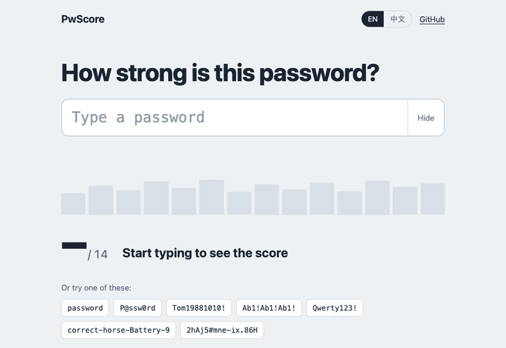
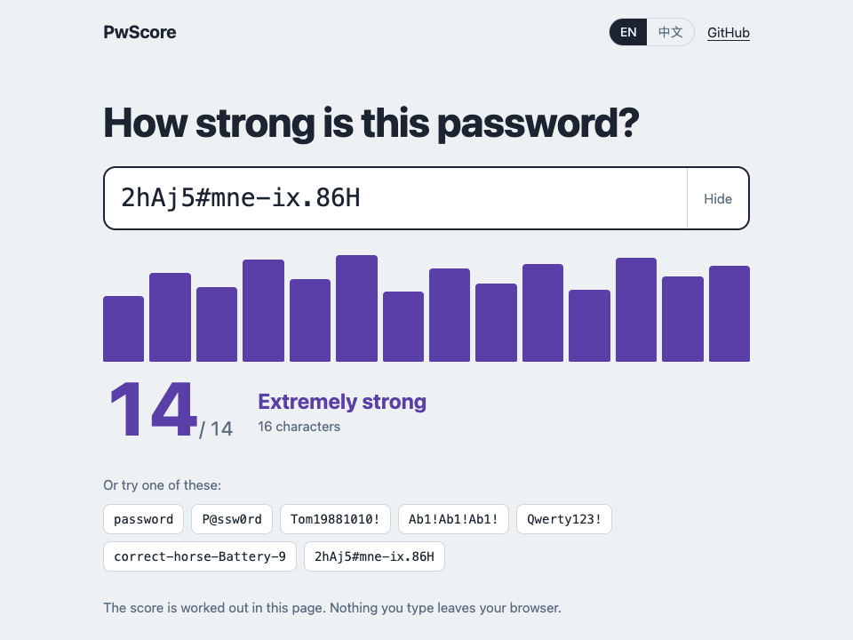
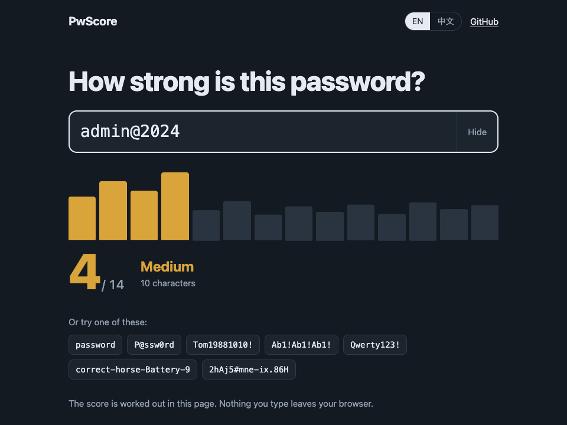
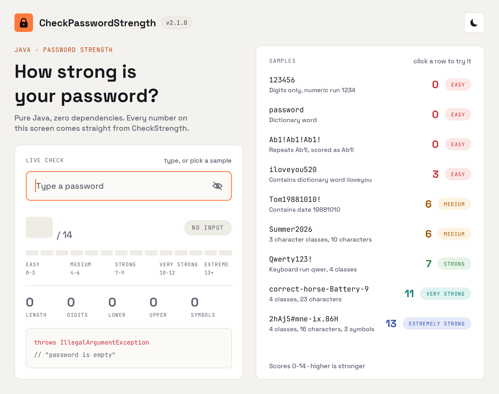

CheckPasswordStrength
==

English | [简体中文](README-CN.md)

[](https://jitpack.io/#venshine/CheckPasswordStrength)  [](https://github.com/venshine/CheckPasswordStrength/actions/workflows/ci.yml)

CheckPasswordStrength is an open-source Java library for checking password strength.

ScreenShot
--


| Light | Dark | Empty input |
|:---:|:---:|:---:|
|  |  |  |

The [Swing sample](sample) scores passwords as you type, shows the raw return values of both APIs, and comes with samples covering all five levels, each labeled with the rule or composition behind its score. Run it from the repository root (Gradle needs JDK 17 or later; the sample itself runs on Java 8+):

```shell
./gradlew :sample:run
```

Desc
--
#### Dictionary
**{"password", "abc123", "iloveyou", "adobe123", "123123", "sunshine","1314520", "a1b2c3", "123qwe", "aaa111", "qweasd", "admin", "passwd"}**

#### Level
* **0-3 : [easy]**
* **4-6 : [medium]**  
* **7-9 : [strong]**  
* **10-12 : [very strong]**  
* **&gt;12 : [extremely strong]**  

Usage
--
Pure Java with no third-party dependencies. It can be called directly from both Java and Kotlin (JVM / Android).

##### Java:
```Java
import com.wx.pwd.CheckStrength;

public class Demo {
    public static void main(String[] args) {
        String passwd = "2hAj5#mne-ix.86H";
        System.out.println(CheckStrength.checkPasswordStrength(passwd));
    }
}
```

```Java
    CheckStrength.LEVEL level = CheckStrength.getPasswordLevel(passwd); // EASY / MEDIUM / STRONG / VERY_STRONG / EXTREMELY_STRONG
```

Both methods throw `IllegalArgumentException` when the password is `null` (`"password is null"`) or empty (`"password is empty"`); any other string, including whitespace, gets a score from 0 to 14. Before 2.1.0, blank strings and the literal `"null"` also threw.

##### Kotlin:
```kotlin
import com.wx.pwd.CheckStrength

fun main() {
    val passwd = "2hAj5#mne-ix.86H"
    println(CheckStrength.checkPasswordStrength(passwd)) // strength score

    when (CheckStrength.getPasswordLevel(passwd)) {
        CheckStrength.LEVEL.EASY, CheckStrength.LEVEL.MEDIUM -> println("Password is too weak")
        else -> println("Password is strong enough")
    }
}
```

Download
--
##### Gradle (via JitPack):
```groovy
repositories {
    maven { url = 'https://jitpack.io' }
}

dependencies {
    implementation 'com.github.venshine:CheckPasswordStrength:2.1.0'
}
```

##### Gradle Kotlin DSL:
```kotlin
repositories {
    maven("https://jitpack.io")
}

dependencies {
    implementation("com.github.venshine:CheckPasswordStrength:2.1.0")
}
```

##### Jar:
[Download the jar](https://github.com/venshine/CheckPasswordStrength/releases/download/2.1.0/CheckPasswordStrength.jar)

> 2.1.0 tightens several scoring rules (length gates, repeated patterns, sequences inside the password, embedded dates), so short, repeated or sequence-based passwords may score lower than in 2.0.0. Blank strings and the literal `"null"` no longer throw. See the [CHANGELOG](CHANGELOG.md).

> 2.0.0 fixes consecutive sequence detection, dictionary word detection and a crash on very long numeric passwords, so some passwords score differently than in 1.x. The enum `LEVEL.MIDIUM` has been renamed to `LEVEL.MEDIUM`. See the [CHANGELOG](CHANGELOG.md).

Test
--
```shell
./test.sh
```

About
--
* Email: venshine.cn@gmail.com

Credits
--
The Swing sample bundles these fonts, both licensed under the [SIL Open Font License 1.1](https://openfontlicense.org) (license texts in [`sample/licenses/`](sample/licenses)):
* [Space Grotesk](https://github.com/floriankarsten/space-grotesk): Copyright 2020 The Space Grotesk Project Authors
* [JetBrains Mono](https://github.com/JetBrains/JetBrainsMono): Copyright 2020 The JetBrains Mono Project Authors

The library itself bundles no fonts.

License
--
    Copyright (C) 2014 venshine.cn@gmail.com

    Licensed under the Apache License, Version 2.0 (the "License");
    you may not use this file except in compliance with the License.
    You may obtain a copy of the License at

    http://www.apache.org/licenses/LICENSE-2.0

    Unless required by applicable law or agreed to in writing, software
    distributed under the License is distributed on an "AS IS" BASIS,
    WITHOUT WARRANTIES OR CONDITIONS OF ANY KIND, either express or implied.
    See the License for the specific language governing permissions and
    limitations under the License.
